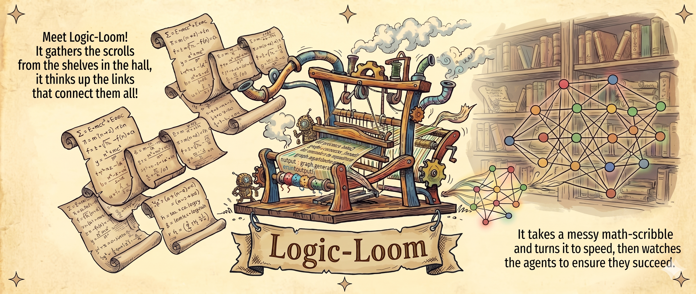

# Meet The Logic-Loom



> *It gathers the scrolls from the shelves in the hall, it thinks up the links that connect them all!*
>
> *It takes a messy math-scribble and turns it to speed, then watches the agents to ensure they succeed.*

This repository builds and publishes the Logic-Loom installers. The app's source, issues
and documentation live in [CEmM2/Logic-Loom](https://github.com/CEmM2/Logic-Loom).

**Documentation: <https://cemm2.github.io/Logic-Loom/>**

## Download

- Latest release: <https://github.com/CEmM2/Logic-Loom-releases/releases/latest>
- All releases: <https://github.com/CEmM2/Logic-Loom-releases/releases>

Each release attaches the macOS, Linux and Windows installers and a `SHA256SUMS.txt`
manifest. Check a download with:

```bash
sha256sum -c SHA256SUMS.txt --ignore-missing          # Linux
shasum -a 256 -c SHA256SUMS.txt --ignore-missing      # macOS
```

Up to v0.3.3 the manifest also listed itself, so that one line reports `FAILED`; the
installers' lines are what matter.

Then follow [Install](https://cemm2.github.io/Logic-Loom/install/index.html) and
[First run](https://cemm2.github.io/Logic-Loom/install/first-run.html). Known problems are
listed on the [Known issues](https://cemm2.github.io/Logic-Loom/known-issues.html) page.

## What Logic-Loom is

A desktop app for research workflows, with six modes:

| Mode | What it is for |
| --- | --- |
| **zsum** | Run the [zotero-summarizer](https://github.com/CEmM2/zotero-summarizer) pipeline and browse the published vault |
| **AKMS** | [AKMS](https://cemm2.github.io/AKMS/) batch node generation, node review, the read-only graph explorer, Learn |
| **Assistant** | Paper discovery (OpenAlex, Semantic Scholar), source batches, workflow runs, Ctrl-K / ⌘K workspace search |
| **MechDSL** | Compile `% mechanics` LaTeX into solver code with [MechDSL](https://cemm2.github.io/MechDSL/) |
| **Failure Memory** | Inspect `.failure-memory` lesson registries |
| **Records** | Browse akms-records stores and their record graph |

The installers bundle the desktop shell, the Python backend and every optional package,
so all six modes are available. Zotero, Better BibTeX, your PDFs and any LLM provider stay
external; the app tells you when one it needs is missing.

## How a release is built

Pushing a `v*` tag here runs [`build-binaries.yml`](.github/workflows/build-binaries.yml).
It checks out the public source at the same tag, builds on macOS, Linux (Ubuntu 22.04,
glibc 2.35) and Windows runners, and attaches the installers and `SHA256SUMS.txt` to the
tag's Release. No secrets are needed. A manual run builds any source ref without
publishing, as a dry run. The source repository's own release carries only the source
archives.

Builds are not yet signed or notarized, so expect macOS Gatekeeper and Windows SmartScreen
warnings on first launch.

## Older material

`docs/`, `release-notes/` and `checksums/` are kept from the alpha releases (through
v0.1.0-alpha.7) and are no longer updated. Current documentation is on the
[docs site](https://cemm2.github.io/Logic-Loom/), and each release's notes are on its
GitHub Release.
